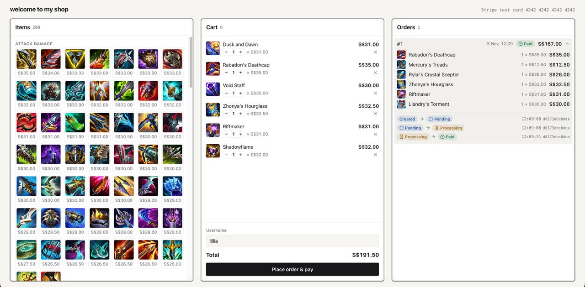
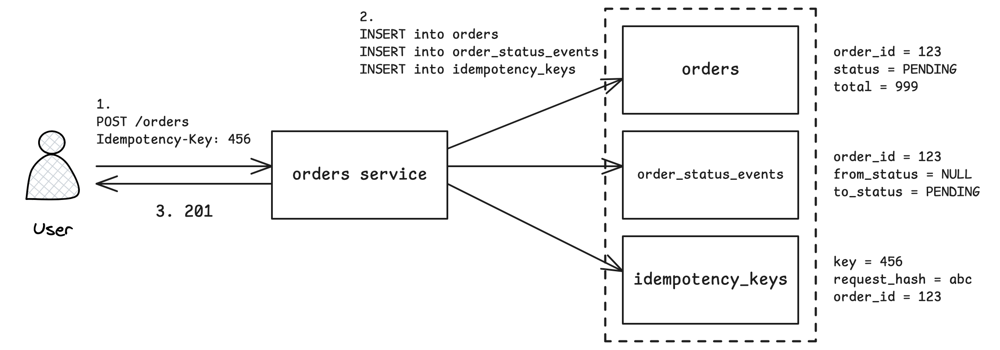
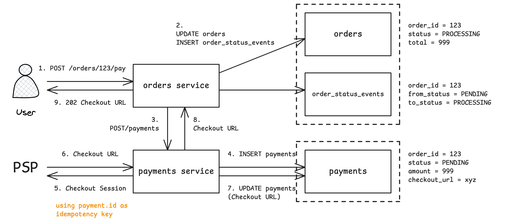
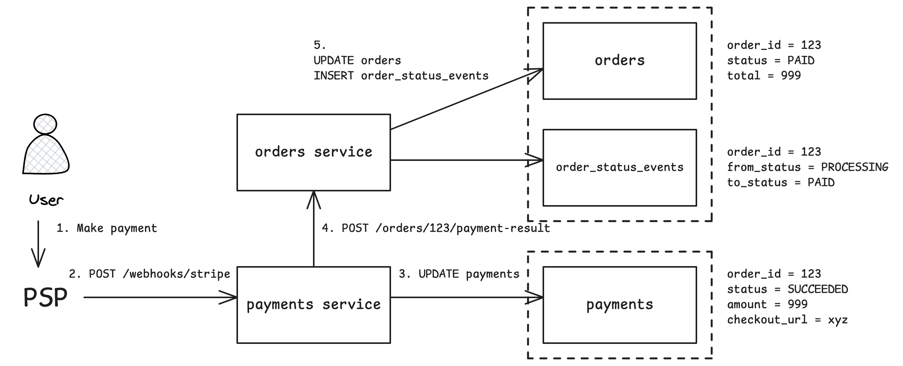

# Demo E-commerce Application

### Overview



<br>

A small online shop which serves as a basis for a hands-on project to learn Kubernetes. The application is split into a few independent services (web, orders service, payments service). Subsequently, I hope to deploy these services to a local Kubernetes cluster with [kind](https://kind.sigs.k8s.io/).

The shop logic is kept simple; add items to cart, checkout (which places an order), make payment. The interesting part is what happens when things go wrong. Issues that could happen include:

- Requests arrive twice

- Services go down mid-payment

- Messages that never arrive

These issues must be addressed in any payments-related service. In this project, I attempt to build a reliable application and learn the core concepts such as idempotency, retries, and reconciliation.

### Try it Out!

#### Prerequisites

- [Docker Desktop](https://www.docker.com/products/docker-desktop/) (or Docker with Docker Compose)

- [Free Stripe account](https://dashboard.stripe.com/register) with test mode switched on, and a test secret key (starts with `sk_test_`)

#### Environment Variables

```bash
cd ecommerce

cp orders/config/.env.example orders/config/.env
cp payments/config/.env.example payments/config/.env
```

1. In both `.env` files, replace the `change-me` values for `POSTGRES_USER` and `POSTGRES_PASSWORD` with anything you like.

2.  In `payments/config/.env`:

    a. Set `STRIPE_API_KEY` to your Stripe test secret key

    b. Leave `STRIPE_WEBHOOK_SECRET` as it is

#### Start

```bash
./start.sh
```

Add `-d` to run it in the background.

This checks your settings, fetches your webhook secret from Stripe (to fill in `STRIPE_WEBHOOK_SECRET`), and starts everything.

#### Buy Some Stuff

Visit the shop at http://localhost:8080. Add some items, enter a username at checkout, and pay with:

- **Card Number: `4242 4242 4242 4242`**

- **Expiry: any future date**

- **CVC: any 3 digits**

The orders and payments API can be found at http://localhost:8000/docs and http://localhost:8001/docs respectively.

#### Things to Try

- **Break orders.** Place an order and get to the Stripe page, then run `docker compose stop orders`. Make payment, then run `docker compose start orders`. The reconcile job should move the order from **PROCESSING** to **PAID**. The job runs separately and does not require the orders API, so this can happen even before orders is back up.

- **Break payments.** Run `docker compose stop payments`, then place an order. It stays **PROCESSING** with no checkout page. Run `docker compose start payments`, then click *Pay* on the order to continue to Stripe. If you wait about a minute first, the reconcile job will already have started the payment for you, and *Pay* simply hands back that checkout page.

- **Abandon a checkout.** Get to the Stripe page, then close it. When the page expires (60 minutes by default), Stripe tells the payments service and the order becomes **PAYMENT_FAILED**. This is final; to buy the items you place a new order.

- **Never pay.** On http://localhost:8000/docs, send `POST /orders`. The order will be **CANCELLED** after 15 minutes (adjustable at `PENDING_ORDER_TTL_MINUTES`).

#### Stop

```bash
./stop.sh
```

Add `-v` to also wipe the databases.

#### Configurable Settings

Defaults work out of the box. The following are worth changing for a faster reconciliation (set them in `orders/config/.env`):

| Setting | Default | What it Controls |
|---|---|---|
| `RECONCILE_PROCESSING_AFTER_SECONDS` | `30` | How long an order can be **PROCESSING** before the reconcile job rechecks it |
| `PENDING_ORDER_TTL_MINUTES` | `15` | How long an order where payment never started lives before it is cancelled |

<details>

<summary>All Settings</summary>

| Setting | Service | Default | What it Controls |
|---|---|---|---|
| `PAYMENTS_TIMEOUT_SECONDS` | orders | `20.0` | How long orders waits for payments to respond |
| `RECONCILE_PROCESSING_AFTER_SECONDS` | orders | `30` | When a **PROCESSING** order gets rechecked |
| `PENDING_ORDER_TTL_MINUTES` | orders | `15` | When an order where payment never started is cancelled |
| `IDEMPOTENCY_KEY_TTL_HOURS` | orders | `24` | How long idempotency keys are remembered |
| `ORDERS_TIMEOUT_SECONDS` | payments | `2.0` | How long payments waits for orders to respond |
| `PENDING_RETRY_AFTER_SECONDS` | payments | `30` | When a stuck payment can be taken over |
| `CHECKOUT_CREATE_DEADLINE_SECONDS` | payments | `600` | When a payment with no checkout page is marked failed |
| `STRIPE_CHECKOUT_EXPIRES_AFTER_MINUTES` | payments | `60` | How long a Stripe checkout page stays open (see note below) |
| `STRIPE_CURRENCY` | payments | `sgd` | Currency charged |
| `STRIPE_SUCCESS_URL` | payments | `http://localhost:8080/orders/{order_id}` | Where Stripe sends you after paying |
| `STRIPE_TIMEOUT_SECONDS` | payments | `5` | How long payments waits for Stripe to respond |
| `STRIPE_MAX_NETWORK_RETRIES` | payments | `2` | How many times a failed request to Stripe is retried |

**Note:** Stripe keeps a checkout page open for at least 30 minutes. To make sure a late retry still gets a usable page, `STRIPE_CHECKOUT_EXPIRES_AFTER_MINUTES` must be at least `CHECKOUT_CREATE_DEADLINE_SECONDS` + 31 minutes (41 with the defaults). Otherwise the payments service refuses to start.

</details>

### Known Simplifications

- **Prices come from the browser.** The website sends the item prices along with the order, and the server trusts them. A real shop would look prices up on the server.

- **No cart service (yet).** The cart is stored in your browser, so it doesn't follow you to another device and disappears if you clear site data.

- **No accounts.** The "user" is just a username you type at checkout.

- **No database migrations.** The tables are created when the services start; changing them means wiping the databases.

- **Reconciliation only covers orders and payments.** If a Stripe webhook is lost (e.g. payments was down when it arrived), the payment is never rechecked with Stripe, so the order stays **PROCESSING**. The Stripe CLI used here does not resend failed events, although real Stripe webhooks are retried for up to 3 days.

### Project Structure

```text
ecommerce/
├── orders/             orders service (API, database models, reconcile job)
├── payments/           payments service (API, Stripe integration, webhooks)
├── web/                React website and nginx config
├── Dockerfile          shared image for the Python services
├── docker-compose.yml  runs everything together locally
├── start.sh            one-command start
└── stop.sh             one-command stop
```

Each service owns its own data and only communicates with the others through their APIs. Services never read each other's databases.

This allows each service to be stopped, restarted, scaled, or replaced, without the others needing to change. It also means things can fail independently (payments might be down while orders is up), which is why we have to account for failure recovery.

### End-to-end Flow

An order starts as **PENDING** when it's placed. Once you start paying it becomes **PROCESSING**, and it stays there until the payment is settled, ending up as either **PAID** or **PAYMENT_FAILED**.

Orders where payment never started are **CANCELLED** automatically after 15 minutes. Orders whose Stripe page expires become **PAYMENT_FAILED**.

**PAID**, **PAYMENT_FAILED** and **CANCELLED** are final. Each order can only ever have one payment, so a failed order cannot be paid again; you place a new order instead.

#### Placing an Order



<br>

1. When you click *Place order & pay*, the website sends your cart to the orders service, along with a unique idempotency key.

2. The orders service writes the order, its first history entry, and the idempotency key together in one database transaction; either all are saved or none are.

3. The website receives the new order.

The website generates the idempotency key and keeps it in the browser's local storage, tied to the contents of your cart. The same cart reuses the same key, even after a page reload. Changing the cart gets a new key.

If anything goes wrong in between, e.g. connection drops before the response arrives, clicking *Try again* resends the same idempotency key. The orders service recognises it and hands back the order it already created, instead of making a duplicate. If someone reuses an idempotency key with a different cart, it will be rejected.

#### Making Payment



<br>

1. The website asks the orders service to pay for the order.

2. The orders service marks the order as **PROCESSING** and asks the payments service to start a payment.

3. The payments service records the payment (at most one per order) and asks Stripe to create a checkout page.

4. Stripe replies with a link to that page.

5. The link is passed back to the website, which sends you to Stripe to enter your card.

At this point the payment is not completed. Payment has to be completed on Stripe's page.

If the payments service is down, the order stays **PROCESSING**. Click *Pay* on the order once payments is back. If a payment was already started for the order, you get the existing checkout link rather than a new one.

#### Stripe Reports the Result



<br>

1. Once you've paid (or the checkout page expires), Stripe sends a webhook to the payments service.

2. The payments service checks that the message really came from Stripe, using a shared secret.

3. It records the result only if the payment has not already been settled, so repeated or late messages change nothing.

4. It tells the orders service, which moves the order to **PAID** or **PAYMENT_FAILED**.

5. If the orders service can't be reached, the order stays **PROCESSING** until the reconcile job picks it up.

The Orders panel on the website refreshes every 3 seconds while an order is still in progress, so you'll see the status change on its own.

### Idempotency

Double-clicks, browser retries, network timeouts and repeated webhooks all mean the same request can arrive more than once. Without guarding against these, customers may end up with two orders, or get charged twice.

The app guards at every step:

- **Placing an order.** The idempotency key means a retried order returns the original instead of creating a new one.

- **Starting a payment.** Each order can only ever have one payment.

- **Creating the Stripe checkout.** Stripe is given its own idempotency key, so it will not create two checkout pages for the same payment request.

- **Receiving webhooks.** A payment that has already been settled ignores any further messages about it.

### Retries

Suppose the payments service records a payment, then crashes before Stripe replies. The payment is now stuck "in progress" with no checkout page.

- If it stays like that for 30 seconds, the next attempt is allowed to take over and finish the job. That attempt comes either from you clicking *Pay* again, or from the reconcile job.

- Since Stripe was given an idempotency key, finishing the job returns the same checkout page instead of creating a new one.

- If a payment still has no checkout page after 10 minutes, it will be marked as failed. There is no timer for this; it happens on the next attempt after the 10 minutes are up.

### Reconciliation

Requests and webhooks can be lost without anyone noticing. Rather than trusting every message to arrive, the reconcile job runs every minute and makes sure orders and payments end up agreeing:

- **Stuck orders.** For orders that have been **PROCESSING** for more than 30 seconds, the reconcile job asks the payments service to pay for the order again, exactly as clicking *Pay* would. Because each order has at most one payment, this is safe to repeat:

    - If the payment already has a result, the order is updated to match.

    - If the payment is still waiting on Stripe, the order is left alone till the next reconciliation.

    - If the payment is stuck with no checkout page, or was never recorded at all (e.g. payments was down when you clicked *Pay*), this attempt starts or finishes it.

- **Unpaid orders.** Orders still **PENDING** after 15 minutes (payment never started) are cancelled.

- **Housekeeping.** Idempotency keys older than 24 hours are cleared out.

Every status change checks the current status first. When two updates race each other, or when an old message arrives late, an order or payment can never be pushed back to an earlier state.
